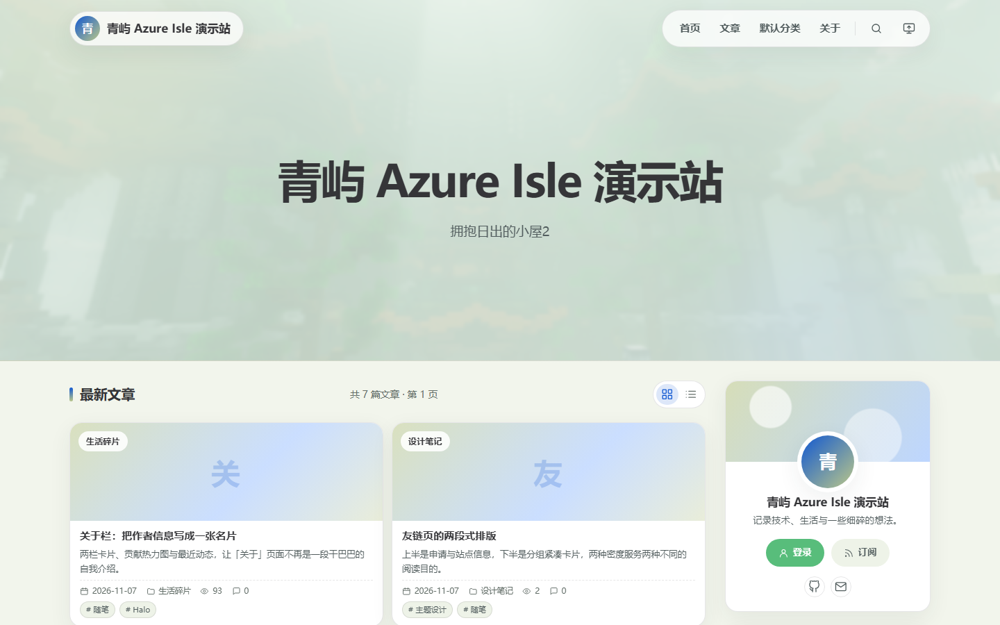

<p align="center">
  
</p>

# 熹屿 Xiyu

一座为文字留白的岛 —— 面向 Halo 2.26+ 的响应式博客主题：杂志式首屏、克制的卡片流、清透的青蓝配色与柔和暗色模式，配合滑动高亮目录、文章入场动效、创作日历、友链自助申请与朋友圈订阅聚合。

<p align="center">
  <a href="https://github.com/YBRC114514/halo-theme-xiyu/releases/latest">下载最新版</a> ·
  <a href="https://github.com/YBRC114514/halo-theme-xiyu/releases">版本记录</a> ·
  <a href="https://github.com/YBRC114514/halo-theme-xiyu/issues">问题反馈</a> ·
  <a href="https://www.halo.run">Halo 官网</a>
</p>



| | |
| --- | --- |
| 主题标识 | `theme-xiyu` |
| 显示名称 | 熹屿 Xiyu |
| 当前版本 | 1.0.16 |
| 要求 | Halo `>= 2.26.0`（2.27.2 实测；评论组件 Next 需 `>= 2.27.0`） |
| 技术栈 | Thymeleaf 模板 + Vite 构建（TypeScript / 原生 CSS） |
| 许可 | [MIT](LICENSE) |

## 安装

1. 前往 [Releases 页面](https://github.com/YBRC114514/halo-theme-xiyu/releases/latest) 下载 `theme-xiyu-1.0.16.zip`（仓库内 `dist/` 也保留了一份同样的构建产物）。
2. 在 Halo 控制台进入「外观 → 主题 → 安装」，上传该 ZIP（无需解压）。
3. 安装完成后点击「启用」。
4. 进入「外观 → 主题 → 设置」按需调整各分组选项。

升级同样通过「安装」上传新版本 ZIP，Halo 会保留已有配置。

> 注意：Halo 以 `metadata.name` 作为主题身份。若你此前安装过 `theme-azure-isle`（本主题的旧标识），它无法直接升级到本包，需先卸载旧主题再安装；旧配置也不会自动迁移，可在安装后重新设置。

## 功能

- **首屏**：可自定义标题、副标题、背景图、模糊度与首屏高度，支持关闭 Banner 直接进入内容。
- **文章列表**：网格 / 列表双视图切换（带过渡动画），摘要两行截断。分页直接使用 Halo 内置 `posts.prevUrl` / `posts.nextUrl`，**每页文章数由 Halo 后台「设置 → 文章设置」统一控制**，主题不再提供可能与之冲突的独立选项。
- **文章页**：滑动高亮目录（长目录自动跟随、不整页跳动）、代码块复制、图注、上下篇导航。封面有两种呈现方式（「外观配色 → 文章封面样式」）：
  - **顶部横幅**（默认）：封面铺满页面顶部，分类、标题、标签胶囊、作者与阅读数据叠加在图上，正文卡片上浮压住横幅底边；此时摘要留给卡片内的「文章摘要」，标签不再在正文底部重复出现；
  - **正文内嵌**（原样式）：封面作为正文里的一张图显示，标题与元信息留在卡片顶部。
  正文另提供**两套可逐篇选择的文章模板**，在 Halo 文章编辑页「设置 → 自定义模板」中切换，不占用主题设置项：
  - **默认模板**（不选自定义模板时的 `post.html`）：借鉴 lcrworld 的毛玻璃排版，整卡半透明、标题统一主题色竖条、虚线下划线链接；
  - **模板二**（`post_robes.html`）：借鉴 robes.xin 的排版，下划线式二级标题、渐变底三级标题、大引号引用块、Mac 风格代码块，以及 hover 从左展开的链接下划线。
- **导航**：桌面端胶囊菜单支持鼠标悬停展开二级菜单；触屏设备使用「电脑模式 / 桌面版网站」时改为点按展开（第一次点按展开子菜单，第二次点按父项才跳转），手机 / 平板仍是抽屉导航。桌面端另有一段不可见悬停桥，保证指针跨过子菜单与父项之间的缝隙时菜单不会闪断。手机抽屉：菜单行撑满面板宽度（展开箭头靠右对齐）、子菜单带缩进竖线分级，打开抽屉时整页变暗（含顶部区域），并对不支持 `color-mix()` 的旧内核浏览器提供实色回退。
- **浮动按钮**：可选「返回顶部」或「返回文章列表」；后者仅在首页生效，点击后平滑滑到文章列表并跳过首屏 Banner，其他页面一律回到顶部。
- **作者页**：资料卡、联系方式与社交入口，可选 MBTI 卡片（类型、中英别名与四条维度占比）。
- **友链页**：站点信息、友链规则、分组紧凑卡片排版。「随机访问」为抽签式跳转——点击后高亮在友链卡片间快速轮播、节奏逐渐放慢，最后停在中签站点并打开（可在「友链页 → 随机访问抽签动画」关闭；系统开启「减少动态效果」时自动跳过）。自助申请支持**两种插件任选其一**（「友链页 → 友链申请方式」）：官方链接插件用主题表单调 `link-applications` REST；[LinksSubmit](https://auth.muyin.site/docs/LinksSubmit) 用主题表单调其 `window.LinksSubmit` 全局 API（图形 / 邮箱验证码、动态分组下拉），也可一键打开插件自带弹窗。未检测到插件时给出提示或跳转备用地址，不会静默失败。
- **朋友圈页**（自定义模板 `friends.html`）：聚合 Halo 官方链接插件订阅的 RSS 动态。
- **暗色模式**：亮 / 暗双套配色，遵循系统偏好并可手动切换，偏好保存在 `localStorage`（`xiyu-scheme` / `xiyu-view`，旧键会一次性迁移）。
- **可访问性**：唯一 `h1`、地标完整、跳过导航链接、可见焦点轮廓、正文与次要文字对比度满足 WCAG AA，尊重 `prefers-reduced-motion`。

## 主题设置

后台「外观 → 主题 → 设置」共 12 个分组：首屏、基础资料、页脚与朋友圈、配色样式、**字体**、布局、功能开关、作者页、友链、SEO，以及**插件联动**。

- 每页文章数请在 Halo 后台「设置 → 文章设置」调整；主题侧已移除同名选项，避免两套分页大小不一致产生空白页。
- 关闭「页脚统计」后主题不会渲染隐藏统计节点，也不会再执行 `postFinder.listAll()`。
- 「插件联动」可分别开关侧栏「一言」「最新瞬间」「评论读者榜」，并设置瞬间条数、读者榜周期与人数、**瞬间页电脑端默认分栏**（单栏 / 两栏 / 三栏）。侧栏三块**默认全部关闭**，需要到后台手动开启。
- 文章排版在**文章编辑页 → 设置 → 自定义模板**里逐篇选择（「默认模板」/「模板二」），主题设置中不再提供全局样式开关。
- 「外观配色 → 文章封面样式」决定文章封面的呈现方式（顶部横幅 / 正文内嵌），对全部文章统一生效。
- 「字体 → 更换字体」可选**系统默认 / 悠哉字体（手写）/ 自定义字体**，选定后在首屏渲染前就把字体栈写到 `<html>` 上，不会先闪一下系统字体。
  - 悠哉字体（Yozai）是落霞孤鹜（LXGW）基于 Y.OzFont 衍生的中文手写字体（OFL 1.1，可免费商用）。字体**随主题包分发、默认离线加载**（`assets/fonts/yozai/`，258 个 woff2 分片约 6.7 MB），按 `unicode-range` 切片，浏览器只会下载当前页面实际用到的字形（通常几十 KB），**不依赖任何第三方服务**。许可全文与版权声明随包附带（`assets/fonts/yozai/OFL.txt`、`NOTICE.md`）。
  - 「字体来源」默认**主题内置**；若想把这部分流量交给公共 CDN，可切到 `jsDelivr` / `Fastly` / `Gcore`，三者内容一致、只是线路不同。
  - 「应用范围」选**仅正文**时，只让文章正文、独立页正文和文章横幅大标题使用所选字体，导航、按钮、侧栏仍用系统字体。
  - 「自定义字体」填字体名 + 一个地址：`…/font.css` 这类 **CSS 地址**会直接引入；`.woff2 / .woff / .ttf / .otf` 的**字体文件地址**会自动生成 `@font-face`（跨域字体需要对方允许 CORS，否则加载失败）。
- 「首屏 → 左上角标识」支持三种来源，优先级从高到低：**内联 SVG 代码** → **图片地址** → **图片附件**，都留空则用站点 Logo（再没有就用站名首字）。「只显示标识、不显示站名」适合本身已含字样的宽幅 logo。
  - 附件上传支持 PNG / JPG / **SVG**——Halo 本身支持 `image/svg+xml`，只是默认存储策略的允许类型是「图片 / 视频 / 音频」，首次上传 SVG 前到「附件 → 存储策略」编辑当前策略、把 **SVG** 勾上即可（勾选后上传、选择、前台渲染全链路正常），没勾会提示「不支持该类型」。
  - SVG 标识按高度等比缩放（桌面 32px、手机 26px，宽度上限 168px / 96px），宽幅 logo 不会被压成小方块。
  - 「内联 SVG 代码」是可选的第三种方式，适合想让标识用 `currentColor` 跟随明暗主题换色、或不想占附件额度的场景；含 `<script>` 或 `on*` 事件的代码会被忽略。
- 「友链页 → 站点信息 · 图标 / 图标地址」决定友链页「站点信息」在「网址」下方多出来的那一行站点图标地址（只显示**完整链接**、不显示缩略图，过长自动换行；站内相对路径会补全成 `http(s)://你的域名/...`，以 `//` 开头的会补成 `https:`；右侧按钮一键复制，访客可直接填进友链申请）：填地址优先，其次是上传附件，两者都留空则自动用 Halo 后台「设置 → 基本设置 → 站点图标」，再没有就用站点 Logo、主题内置 favicon。
- 「友链页 → 随机访问抽签动画」控制点击「随机访问」时是否先轮播高亮再跳转；关闭后立即打开随机友链。
- 页脚「Powered by Halo · XiYu」中的 XiYu 固定指向本主题仓库，不再提供修改入口；如需隐藏整行可关闭「显示 Powered by Halo · XiYu」。
- 「友链页 → 友链申请方式」决定由官方链接插件还是 LinksSubmit 接收申请；选 LinksSubmit 时还能指定「主题表单 / 插件自带弹窗」与「图形 / 邮箱验证码」。LinksSubmit 为第三方授权插件，需自行购买安装（Halo ≥ 2.20.14），主题只调用其公开全局 API，不捆绑插件代码。

## 插件兼容

| 插件 | 标识 / 版本 | 主题提供的能力 |
| --- | --- | --- |
| `plugin-links`（Halo 官方链接插件） | `PluginLinks` 2.5.0 | 友链页 `links.html`、朋友圈 `friends.html` 的 RSS 动态与匿名申请接口 |
| `plugin-equipment` | 1.1.1 | 装备页 `equipments.html` |
| `plugin-steam` | 1.0.0 | Steam 游戏页 `steam.html` |
| `plugin-comment-next` | `PluginCommentNext` 1.1.1，Halo ≥2.27 | 文章 / 独立页 `<halo:comment />` 评论区、评论框配色变量、侧栏「评论读者榜」 |
| `plugin-moments` | `PluginMoments` 1.19.0 | `/moments` 列表页 `moments.html`、`/moments/{name}` 详情页 `moment.html`、侧栏「最新瞬间」 |
| `plugin-hitokoto-hub`（轻言） | `hitokoto-hub` 3.0.0 | 侧栏「一言」（服务端 Finder 渲染 +「换一句」公开 API）、页脚入口 |
| [LinksSubmit](https://auth.muyin.site/docs/LinksSubmit)（木因，第三方授权插件） | Halo ≥ 2.20.14 | 友链自助申请：`window.LinksSubmit.submit / getCaptchaUrl / sendVerifyCode / getLinkGroups` 全局 API，或 `openLinksSubmitOverlay()` 插件弹窗；与官方链接插件**二选一**，不需要同时启用 |

主题不依赖任何插件：以上插件全部未安装时，首页、文章、归档、分类、标签、作者页等核心页面照常工作。

### 关于「未安装插件」的实际行为

这一点需要区分两类页面，主题的表现并不相同：

1. **插件注册的路由页面** —— `/links`（plugin-links）、`/equipments`（plugin-equipment）、`/steam`（plugin-steam）、`/moments` 与 `/moments/{name}`（plugin-moments）、`/hitokoto`（plugin-hitokoto-hub，页面由插件自带模板渲染）。这些 URL 由插件在启用时注册，主题只负责提供模板 / 数据展示。**插件未安装或未启用时路由根本不存在，访问会得到 404，模板不会渲染，也不会出现「空态提示」。** 请先启用插件，再到「外观 → 菜单」把对应路径加入导航；`/moments` 的列表与详情模板由本主题提供，`/hitokoto` 则由插件自带页面呈现，视觉可能与主题其余页面略有差异。
2. **主题内的可选模块 / 独立页** —— 侧栏「一言」「最新瞬间」「评论读者榜」，以及文章 / 独立页的评论区。这些位置都用 `pluginFinder.available()` 做了守卫，插件未启用时**整块不渲染**，其余内容不受影响。用户自行创建的独立页（例如选择 `friends.html` 的 `/friends` 朋友圈页）即使插件未启用也能打开，只是动态数据请求失败时列表为空。友链申请按钮在所选插件未就绪时会提示「未检测到插件」或跳转备用地址，不会提交到错误接口。

另外：评论组件 Next 实现的是 Halo 的 `comment-widget` 扩展点，主题已在 `post.html` / `page.html` 输出 `<halo:comment />`，安装并启用插件后评论区会自动换成新版组件；Halo 自带的 `PluginCommentWidget` 与它请不要同时启用。

### 瞬间页排版（`/moments`）

`moments.html` 默认是单列信息流：卡片居中（最宽 880px）、按发布时间**从新到旧**从上往下读。

- **电脑端可分栏**：页面右上角有 1 / 2 / 3 栏切换按钮，访客点一下即换（页面同时放宽到 1160px / 1400px），选择记在浏览器 `localStorage`（`xiyu-moments-cols`），下次打开还是自己挑的那档。后台「插件联动 → 瞬间页电脑端分栏」设的是**默认档**，访客没选过时按它渲染；手机端（≤900px）一律单栏、按钮隐藏。
- 多栏只保证**每栏宽度等分**，卡片高度各随内容、不强行对齐：脚本按卡片实际高度折算成跨行数，所以纵向间距恒为 16px，不会因为同一行里有个高个子而空出一大片，也不会出现卡片重叠。
- 头部显示作者头像（没设头像时用昵称首字的渐变块兜底）、昵称（链到 `/authors/{name}`）与时间；时间由浏览器换算成访客本地时区，一周内显示「刚刚 / N 分钟前 / 昨天 09:12」，更久显示「月-日 时:分」，完整时间在 `title` 里。
- 单张图片**按原比例完整展示**（限高 460px、不裁切，竖长截图也看得全），多图走两列方形网格；点任意图片打开灯箱看原图，点图片 / 点遮罩 / `Esc` 都能关。
- 图片解码完成后再淡入，不会闪半张图；卡片本身用主题统一的 `data-reveal` 交错进场，`prefers-reduced-motion` 下直接显示。
- 底部一条操作栏：左边标签胶囊（点进对应标签筛选），右边「查看详情」；详情页 `moment.html` 放宽图片高度限制、去掉「查看详情」自链。

## 版本记录

| 版本 | 主要内容 |
| --- | --- |
| **1.0.20** | ① 新增「字体」设置分组：可把字体换成**悠哉字体（Yozai，手写体，OFL 1.1 可免费商用）**或**自定义字体**（CSS 地址直接引入 / 字体文件自动生成 `@font-face`），可选全站或仅正文生效；字体**随主题包内嵌分发、默认离线加载**，也可切到 jsDelivr / Fastly / Gcore 三个 CDN。② **瞬间页（`/moments`）排版重做**：改为单列信息流，单图按原比例完整展示、多图方形网格、图片点击灯箱、图片淡入与卡片交错进场、作者头像与作者页链接、标签与「查看详情」合并到底部操作栏；**电脑端可切换 1 / 2 / 3 栏**（访客自选并记住，后台可设默认档，多栏等宽不等高） |
| **1.0.19** | 友链页「站点信息」在「网址」下方新增「图标」行：只显示**完整图标地址**（不显示缩略图，站内相对路径自动补全成 `https://域名/...`，过长自动换行），右侧按钮一键复制，方便访客直接填进友链申请。图标可自定义（「友链页 → 站点信息 · 图标」上传附件，或「图标地址」填外链，地址优先），两者留空时自动取 Halo 后台「设置 → 基本设置 → 站点图标」，再回退到站点 Logo 与主题内置 favicon |
| **1.0.18** | 站点左上角标识支持三种来源：附件上传（含 SVG）、图片地址、内联 SVG 代码，并新增「只显示标识、不显示站名」开关；SVG 标识按高度等比缩放，宽幅 logo 不再被压成小方块，手机端自动收窄；横幅内以标签胶囊替代摘要。**SVG 附件可直接上传，若提示不支持请在「附件 → 存储策略」把 SVG 勾进允许类型**（默认策略只含图片 / 视频 / 音频） |
| 1.0.17 | 底部栏恢复 1.0.15 形态（移除页脚插件入口）；首页浮动按钮箭头统一向上；文章封面上移到页面顶部做沉浸式横幅（「外观配色 → 文章封面样式」可在横幅 / 正文内嵌间切换，横幅内以标签胶囊替代摘要，正文底部不再重复标签）；文章排版改为「默认模板 / 模板二」两套自定义文章模板，移除设置页「文章内样式」并固定主题仓库链接；友链「随机访问」加入抽签轮播动画并可关闭；友链申请支持官方链接插件与 LinksSubmit 二选一（主题表单 / 插件弹窗、图形 / 邮箱验证码）；优化手机抽屉（菜单行撑满、子菜单分级缩进、打开时整页变暗、旧内核 `color-mix` 回退）；新增鸣谢 |
| 1.0.16 | 修复手机「电脑模式」二级菜单无法点击；适配 `plugin-comment-next`、`plugin-moments`、`plugin-hitokoto-hub`；落实 Halo 官方审核建议（预览图站名、分页改用 `prevUrl/nextUrl`、关闭统计时跳过查询、localStorage 换 `xiyu-` 前缀、README 插件路由说明） |
| 1.0.15 | 修复桌面端二级菜单移入即消失（`prefers-reduced-motion` 下 10px 悬空缝导致） |
| 1.0.14 | 首个公开发布版：统一标识为 `theme-xiyu`，新增返回文章列表按钮、页脚署名、主题图标；修复长内容溢出与可访问性问题 |

完整变更请见 [Releases](https://github.com/YBRC114514/halo-theme-xiyu/releases)。

## 验证

1.0.16 在本地 Halo 2.27.2（实装三个新插件）完成真机回归，**440 项断言、0 失败**：

- 1.0.16 专项验证 109 项：静态契约、插件联动、分页三页、统计开关、localStorage 迁移、触屏电脑模式菜单、桌面 hover 与 3440×1440 带鱼屏 `reduced-motion` 回归、5 档视口溢出与抽屉
- 发布审计 301 项、可访问性审计 17 项、插件审计 13 项

覆盖 3440×1440 / 1920×1080 / 1024×768 / 768×1024 / 390×844 等视口。

1.0.18 热升级后实测标识专项 26 项：附件 SVG 渲染、内联 SVG 尺寸与 `currentColor`、含 `<script>` 的代码被忽略、三项全空回退、宽幅 lockup 等比缩放不被压扁、隐藏站名、手机端收窄、品牌胶囊与按钮组等高对齐且无横向溢出，0 失败。

1.0.17 在同一实例热升级后另行回归：手机抽屉遮罩与菜单宽度 19 项、两套文章模板的正文元素计算样式与毛玻璃容器、Console「自定义模板」下拉选项、设置表单移除项，均 0 失败。文章横幅与随机访问动画另跑 29 项：横幅满宽 / 压住页头 / 卡片上浮 / 单一 `h1` / 手机断点，以及动画开关、轮播次数、中签高亮、立即跳转、`prefers-reduced-motion` 跳过，同样 0 失败；横幅标签化另跑 20 项（胶囊样式与悬停、底部标签移除、无封面回退、手机断点），0 失败。LinksSubmit 为第三方授权插件，本地未安装，其 23 项分支（字段映射、两类验证码、分组加载、插件弹窗、插件缺失兜底）通过等价的 `window.LinksSubmit` 模拟桩验证。

1.0.20 字体专项 46 项 0 失败：系统默认不引入任何字体资源、**主题内置**模式下字体样式表指向 `/themes/theme-xiyu/assets/fonts/yozai/yozai.css`、页面**零第三方请求**（所有 woff2 分片都来自本站）、CSS 内分片为相对路径且可访问、`document.fonts.check("16px Yozai")` 为真、随包附带 `OFL.txt` 许可、`jsdelivr / fastly / gcore` 三个 CDN 节点 href 正确、「仅正文」时界面回落系统字体而正文与大标题用 Yozai、自定义 CSS 地址直接引入、自定义 woff2 地址自动生成 `@font-face`、字体名为空时静默回落、向字体名注入 `<script>` 不会执行且尖括号不进 CSS、手机端（390px）无横向溢出与第三方请求、暗色模式生效、运行期无 JS 报错。瞬间页排版专项 30 项 0 失败：默认单栏 grid 布局且卡片等宽、按时间倒序、头像 44px（无头像时用首字渐变块兜底）、昵称链到 `/authors/{name}`、单图按原比例完整展示（限高 460px 不裁切）、多图两列方形网格、底部标签与「查看详情」同排、`data-reveal` 全部进场、灯箱打开后显示所点图片且可关闭、详情页放宽限高且无自链、390 / 360 视口无溢出、暗色下卡片与文字可读。分栏专项 35 项 0 失败：默认单栏、按钮仅在 ≥901px 出现、点 2 / 3 栏后同列等宽（572 / 572 与 456 / 456 / 456）、两两无重叠、同列间距恒 16px、刷新后记住选择、1280 视口三栏不溢出、手机端按钮隐藏且恒单栏、暗色两栏正常。后台默认分栏 10 项 0 失败：把 `plugins.moments_columns` 改为 2 后新访客（无 `localStorage`）直接两栏且按钮高亮第二档、后台「插件联动」组出现「瞬间页电脑端分栏」且三个选项齐全、改回 1 立即恢复单栏、访客自选优先于后台默认。同时回归图标专项 26 项、品牌标识 26 项、横幅与随机访问 29 项、LinksSubmit 23 项，均 0 失败。

## 本地开发

```bash
npm install
npm run build-only   # 仅构建 templates/
npm run build        # 构建并打包 dist/theme-xiyu-<version>.zip
npm run dev          # watch 模式，边改边构建
```

模板使用 Thymeleaf 原生布局契约：页面通过 `~{layout :: html(head = ~{::head}, content = ~{::content})}` 复用 `templates/layout.html`，公共片段位于 `src/partials/`，由构建期 `<include>` 展开。CSS 与 JS 只在 `layout.html` 引入，由 Vite 注入哈希资源名。

## 目录结构

```
├── src/                 # 源码（Thymeleaf 模板、partials、CSS、TS）
│   ├── partials/        # 公共片段，构建期被 include 展开
│   ├── moments.html     # plugin-moments 列表页模板
│   ├── moment.html      # plugin-moments 详情页模板
│   ├── post.html        # 默认文章模板（毛玻璃）
│   ├── post_robes.html  # 模板二（Robes 排版）
│   ├── css/main.css     # 亮/暗双套变量的主样式
│   └── js/main.ts       # 交互：导航抽屉与二级菜单、目录高亮、视图切换、插件模块等
├── public/              # 原样复制的静态资源
│   ├── assets/gateway.css
│   ├── assets/logo.svg  # 主题标识（线条版，随文字颜色变化）
│   ├── assets/favicon.svg  # 站点图标（深底圆形，未设置站点 favicon 时兜底）
│   └── error/error.html # 错误页（独立骨架）
├── assets/              # 品牌素材：icon-{512..16}.png 与 social-preview.png
├── templates/           # 构建产物：最终主题模板与哈希资源
├── dist/                # 构建产物：可安装的 ZIP
├── theme.yaml           # 主题元信息（标识、版本、配置资源名）
├── settings.yaml        # 后台设置表单（FormKit）
└── screenshot.png       # 主题预览图
```

`templates/` 与 `dist/` 已在仓库中保留一份构建结果，便于直接取用；修改 `src/` 后请重新构建，避免两者不一致。

## 字体与第三方资源

主题默认使用访客系统自带的中文字体（PingFang SC、微软雅黑、Hiragino Sans GB 等）；若在设置里选择「悠哉字体」，主题会使用**包里自带的字体分片**离线渲染，不发起任何第三方请求。

| 字体 | 作者 / 来源 | 许可 | 免费商用 | 分发方式 |
| --- | --- | --- | --- | --- |
| 悠哉字体 Yozai | 落霞孤鹜（LXGW），衍生于 Y.OzFont | SIL Open Font License 1.1 | ✅ 允许 | 随主题包内嵌（可选切 CDN） |

内嵌位置 `assets/fonts/yozai/`（258 个 woff2 分片 + `yozai.css` + `OFL.txt` + `NOTICE.md`），来源是 npm 包 `cn-fontsource-yozai-regular@1.0.9` 按 `unicode-range` 切好的分片，字形未经改动。

### 免责声明

1. **授权以官方仓库为准**：悠哉字体的许可信息来自其官方仓库 [lxgw/yozai-font](https://github.com/lxgw/yozai-font) 的 `OFL.txt`（SIL Open Font License 1.1，`OFL-1.1`）。若作者日后调整授权，以官方最新声明为准；本主题不对该字体的授权状态作担保。
2. **OFL 1.1 的边界**：该许可允许免费商用、修改与再分发，但**不得单独售卖字体本身**；再分发时须附带许可与版权声明，且不得使用保留字体名（Reserved Font Name，本字体为含 `Y.Oz` / `YOz` 的字样）。主题已按此执行：随包附带 `OFL.txt`（OFL 1.1 全文）与 `NOTICE.md`（版权行、来源、未改动说明），字体族名仍为上游的 `Yozai`，未改名、未改字形、未二次子集化。
3. **删除请求**：若字体作者或权利人希望主题停止分发，请在 [Issues](https://github.com/YBRC114514/halo-theme-xiyu/issues) 说明，我们会在下一个版本中移除该字体并改回仅 CDN 引用。
4. **CDN 选项**：把「字体来源」切成 jsDelivr / Fastly / Gcore 后，字体分片改由对应服务商提供，加载速度与可用性取决于该服务；加载失败时浏览器自动回退系统字体。若站点对第三方请求有合规或隐私要求，请保持默认的「主题内置」。
5. **自定义字体由站长负责**：使用「自定义字体」填入的 CSS / 字体文件地址及字体版权，由站长自行确认授权并承担相应责任；主题只负责按填写的地址引入，不校验其授权状态。
6. **责任限制**：因使用第三方字体引发的版权或授权纠纷，由使用者自行承担，主题作者不承担责任。

## 反馈与许可

使用中遇到问题请到 [Issues](https://github.com/YBRC114514/halo-theme-xiyu/issues) 反馈，附上 Halo 版本、浏览器与视口宽度、控制台报错会更便于定位。欢迎 PR 与主题截图分享。

基于 [MIT](LICENSE) 许可发布。

## 鸣谢

熹屿在设计与开发过程中参考、借鉴了以下优秀主题与站点，感谢这些作者的无私分享：

- **[LiuShen's Blog](https://blog.liushen.fun)**（LiuShen / Willow-God）—— 顶部胶囊导航的形态与悬停动效、亮暗双套配色灵感。
- **[xhhao's Blog](https://www.xhhao.com)** —— 友链页的分组紧凑卡片排版、导航悬停 / 当前项下划线动效，以及文章页顶部封面横幅的排版（标题、标签胶囊、作者与阅读数据叠加在封面上）。
- **[lcrworld.xyz](https://lcrworld.xyz)**（LCR）——「默认模板」文章排版：毛玻璃正文容器、统一标题竖条、虚线下划线链接。
- **[Robes](https://robes.xin/1258.html)** ——「模板二」文章排版：下划线式标题、渐变底小标题、大引号引用块、Mac 风格代码块与圆形列表序号。
- **[Halo](https://www.halo.run)** 与各插件作者 —— [plugin-links](https://github.com/halo-sigs/plugin-links)、[plugin-comment-next](https://github.com/acanyo/plugin-comment-next)、[plugin-moments](https://github.com/halo-sigs/plugin-moments)、[plugin-hitokoto-hub](https://github.com/imorisun/plugin-hitokoto-hub)，以及 plugin-equipment、plugin-steam 的作者。开放的 Finder API 与扩展点让主题的插件生态成为可能。
- **[Halo 官方文档](https://docs.halo.run)** 与 Halo 社区 —— 主题开发规范、审核建议与问题支持。
- **[悠哉字体 Yozai](https://github.com/lxgw/yozai-font)**（落霞孤鹜 LXGW，衍生于 Y.OzFont）—— 「更换字体」中的中文手写字体，SIL OFL 1.1；字体分片随主题包分发，许可与版权声明见 `assets/fonts/yozai/`。
- **[cn-fontsource](https://github.com/wc-ex/cn-fontsource)**（wc-ex）—— 提供按 `unicode-range` 分片的中文字体包，让 CJK 字体可以按需加载；主题内嵌的悠哉字体分片即取自其 `cn-fontsource-yozai-regular@1.0.9`。

以上站点仅作设计参考，所有代码均为独立实现；若您是上述作者并希望调整署名或链接，请到 [Issues](https://github.com/YBRC114514/halo-theme-xiyu/issues) 告知。
